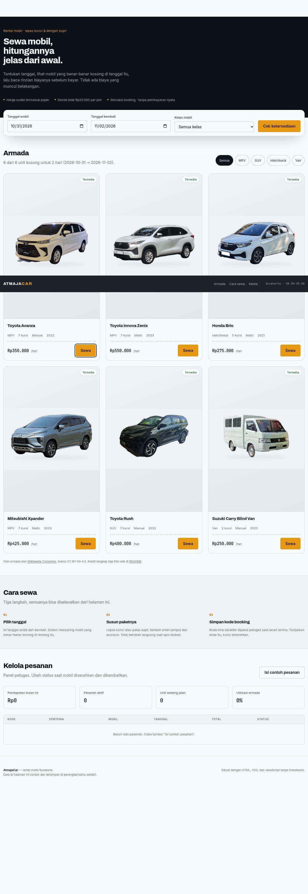

# AtmajaCar

A browser-based car rental prototype with date-range availability, transparent cost breakdowns, and a local booking management panel.

[Open demo](https://atmajadesna.github.io/atmajacar/)



## Features

- Six sample vehicles with class filters and date-range availability.
- Itemized rental estimates with driver, airport transfer, insurance, and separate deposit calculations.
- Booking form and locally stored booking references.
- Management panel for booking status and sample operational statistics.
- Responsive fleet cards, keyboard focus indicators, and reduced-motion support.

## Run locally

```bash
python3 -m http.server 8000
```

Open `http://localhost:8000`. No build step is required. Fonts load from Google Fonts.

## Demo limitations

This is a simulation, not an operating rental service. Availability depends only on bookings in this browser's local storage. There is no shared database, authenticated staff access, payment processing, or actual booking confirmation. Prices and operational claims are sample data. Do not enter real identity-card, driving-license, or contact details. Browser data may be inspected or edited and can be lost when storage is cleared.

Production use requires authenticated server-side booking management, authoritative pricing and availability, validation, secure personal-data handling, and privacy controls.

## Verification

`tests/ui.cjs` checks fleet rendering, class filtering, dialog opening and Escape dismissal, horizontal overflow, and runtime errors at six viewport widths. It requires Playwright. These checks do not constitute a complete security or booking-calculation audit.

## Files

- `index.html`: page structure, search, booking dialog, and management panel.
- `app.js`: sample fleet, pricing, availability, booking state, and storage.
- `styles.css`: responsive interface components.
- `tokens.css`: color, typography, spacing, and motion tokens.

## Photo credits

Vehicle images are adapted from Wikimedia Commons. The existing image set is distributed as CC BY-SA 4.0 derivatives with backgrounds removed and replaced. Consult each source page for authorship and original licensing details.

- Toyota Avanza: [2022 Toyota Avanza 1.3 E, IIMS Hybrid](https://commons.wikimedia.org/wiki/File:2022_Toyota_Avanza_1.3_E,_IIMS_Hybrid,_Grand_City,_Central_Surabaya.jpg)
- Toyota Innova Zenix: [2022 Toyota Kijang Innova Zenix V](https://commons.wikimedia.org/wiki/File:2022_Toyota_Kijang_Innova_Zenix_V_(Indonesia)_front_view.jpg)
- Honda Brio: [2023 Honda Brio Satya E](https://commons.wikimedia.org/wiki/File:2023_Honda_Brio_Satya_E_(front_left),_Citraland,_West_Surabaya.jpg)
- Mitsubishi Xpander: [2018 Mitsubishi Xpander Ultimate](https://commons.wikimedia.org/wiki/File:2018_Mitsubishi_Xpander_Ultimate_1.5_NC1W_(20190623).jpg)
- Toyota Rush: [2022 Toyota Rush GR-S](https://commons.wikimedia.org/wiki/File:2022_Toyota_Rush_GR-S_20221010.jpg)
- Suzuki Carry Blind Van: [2021 Suzuki Carry FB](https://commons.wikimedia.org/wiki/File:2021_Suzuki_Carry_FB_(DC61T).jpg)

The application code is MIT licensed; see [LICENSE](LICENSE). Image licenses remain separate.
